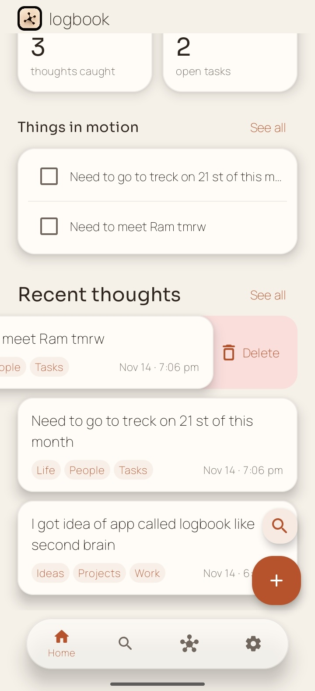
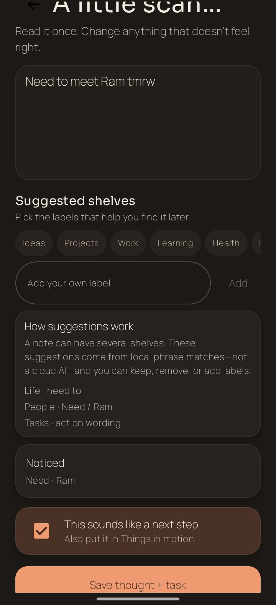
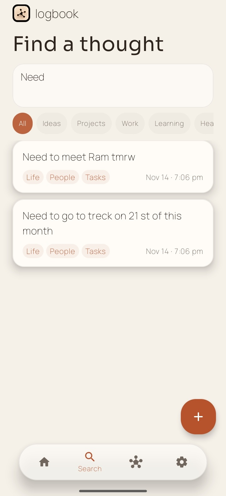

<div align="center">

# Logbook

**Your private second brain for thoughts and next steps.**

Capture an idea, reconnect it to what you have saved, and keep what matters in view—all on your phone.

[Visit the website](https://vijayarkananduri.github.io/logbook/) · [Read the guide](https://vijayarkananduri.github.io/logbook/guide.html) · [Get Logbook](https://github.com/vijayarkananduri/logbook/releases/latest) · [](LICENSE)





</div>

---

## Your thoughts, connected

Logbook is a private second brain for Android. As you write, it can surface related thoughts from what you have already saved. Home keeps today’s thought count and open tasks in view, while search and hubs help you return to ideas, people, projects, and topics later. Matching is local keyword and phrase logic—not cloud AI or automatic duplicate blocking.

## What it does

- **Capture:** write a thought or dictate with Android on-device speech recognition when available.
- **Reconnect:** see up to two locally matched related thoughts while composing or reviewing, then choose whether to revisit them.
- **Find:** search notes by text, links, people, dates, shelves, and topics.
- **Connect:** browse hubs for people, projects, and topics that recur in your notes.
- **Keep tasks moving:** when local rules notice action wording, choose whether to make a task; set a due date or explicitly save without one.
- **See the day clearly:** Home shows how many thoughts you caught today and how many tasks remain open, with up to two tasks at a glance. Optional morning and evening check-ins are separate from task alarms.
- **Take your writing with you:** export or import a JSON copy whenever you choose.

## Private by design

Thoughts and tasks stay in an encrypted SQLCipher database on your device. Logbook has no account, sync, ads, analytics, network AI, or remote speech fallback. Labels, date detection, task suggestions, related-thought matching, and hubs run locally. The manifest has no `INTERNET` permission, and automatic cloud and device backups are disabled.

Both notifications and microphone access are optional. If you decline either permission, typing and the rest of the app remain available.

## Get Logbook

1. Open the [latest release](https://github.com/vijayarkananduri/logbook/releases/latest).
2. Download `app-debug.apk` and open it on your phone.
3. If Android asks, allow installs from your browser or file manager, then tap **Install**.

## Build from source

Use JDK 17 and Android SDK 35. From the repository root, run:

```bash
gradle --no-daemon :app:assembleDebug
```

The APK is written to `app/build/outputs/apk/debug/app-debug.apk`.

## Built with

Kotlin, Jetpack Compose, Material 3, and SQLCipher.

## Keep your data safe

JSON exports contain your personal writing, so choose a destination you trust. Export a copy before uninstalling: removing the app or losing its Android Keystore key can make the encrypted local database unavailable.

## License

Logbook is open source under the [MIT License](LICENSE).
